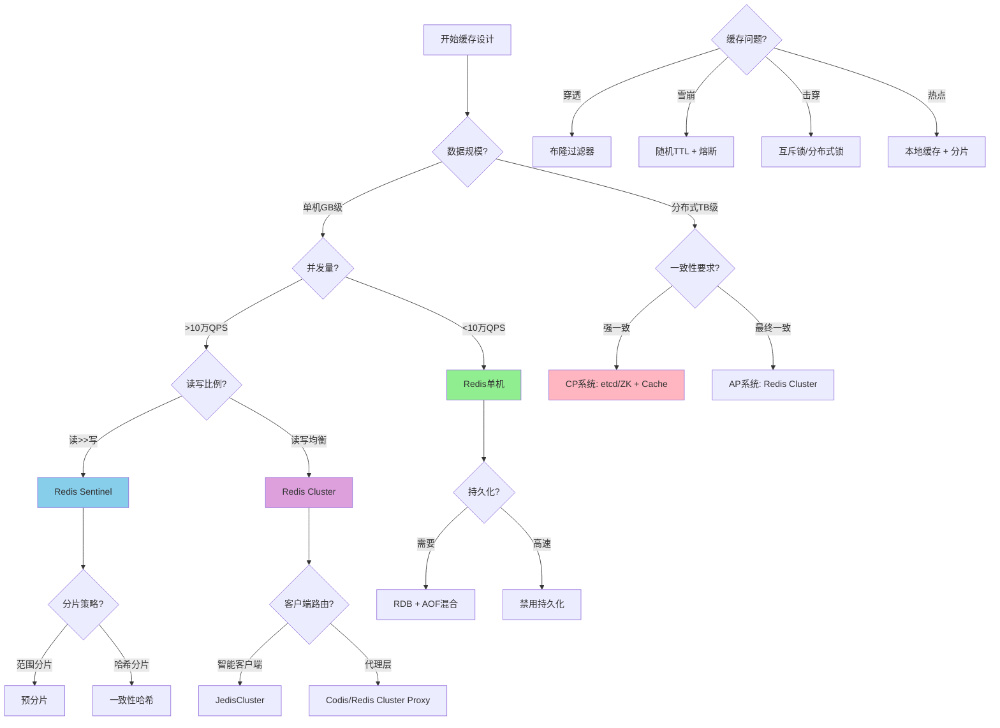
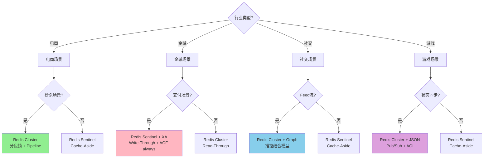
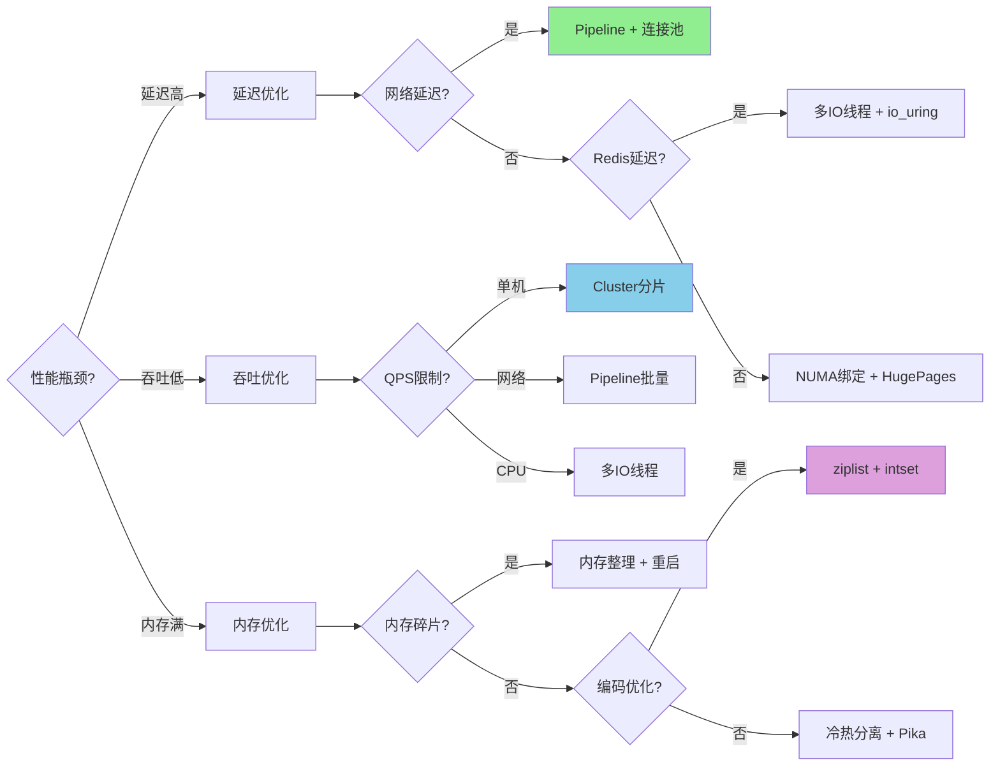
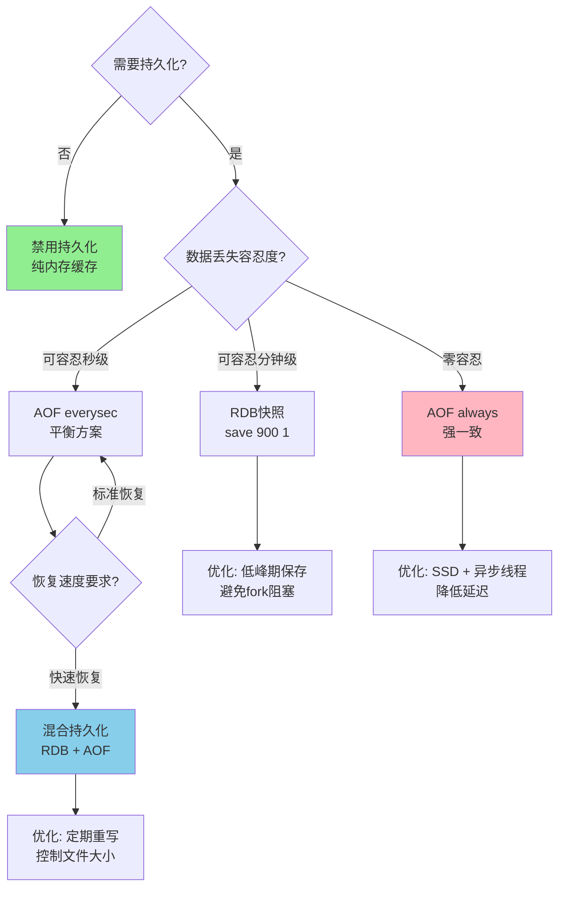
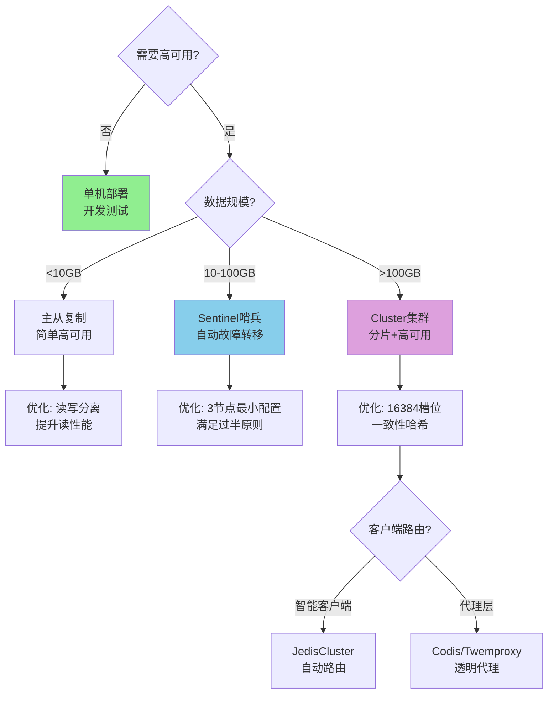
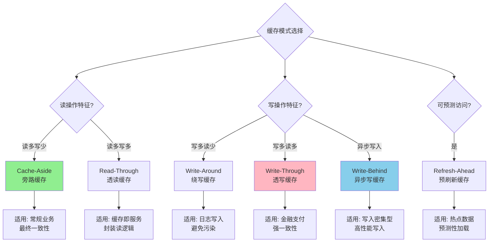

# 决策图网：缓存架构选择路径

> **v2（2026-11-18）**：按 [全局一致性规范](全局一致性规范.md) §3 升级为三层索引结构——L1 领域路由（本节）→ L2 领域子树（登记于 §0.2）→ L3 判定叶（= 文档章节，叶子判定条件与正文逐字一致）。判定指纹清单（§0.3）是决策层一致性的检测单元。

## 0. 决策图网 v2 三层索引

### 0.1 L1 领域路由（总入口）

```mermaid
graph TD
    S[缓存设计问题] --> D{属于哪个领域?}
    D -->|部署形态/容量| T1[主决策树 §1 规模-并发-一致性]
    D -->|读写模式选择| T2[架构模式子树 04.01]
    D -->|持久化策略| T3[持久化决策 03.02.06 §4]
    D -->|内存治理| T4[驱逐决策 03.04.05 §1 / 过期治理 03.04.06]
    D -->|事务与脚本| T5[事务选型 03.03.05 §6 / Lua 治理 03.03.06 §5]
    D -->|弹性伸缩| T6[伸缩分层 07.09.01 §6 / 分片伸缩 07.09.04 §5]
    D -->|韧性验证| T7[混沌剧本 S1-S3 执行计划 §4]
    D -->|云与部署| T8[云原生选型 04.03.16 §6 / 代理层 04.06.05 §4]
    D -->|消息与流| T9[Streams vs MQ 04.03.19 §2]
    D -->|LLM 推理| T10[LLM 部署路径 04.03.17 §3 / 观测 SLO 04.03.18 §3]
    D -->|客户端接入| T11[客户端矩阵 03.06.07 §5]
    D -->|版本与升级| T12[升级迁移 07.05.05 §1 / 引擎选型 03.05]
    D -->|数据可信| T13[对账判据 04.04.11 §3 / 读一致性级别 04.04.10 §3]
    D -->|性能诊断| T14[诊断决策树 07.07.03 §1 / 边界估算 05.06.07 §3]
    D -->|缓存角色(PG内嵌/外部)| T15[PG18缓存边界 02.03.07 §3]
    D -->|内容分发/边缘| T16[CDN 架构 04.03.20 §4]
    D -->|开源选型| T17[开源全景 03.05.01 §3]
```

**递归跳转规则**：每个 Ti 节点进入对应 L2 子树；子树节点可反向引用 L1（跨领域问题先回路由）；L3 叶子必须带文档锚点且条件与正文一致（第五道门禁校验）。

### 0.2 L2 领域子树登记（权威源清单）

| 子树 | 权威源 | 覆盖判定 |
| ---- | ------ | -------- |
| 主决策树（规模/并发/一致性/持久化/分片） | 本文 §1-§2 | 部署形态全链 |
| 架构模式（Cache-Aside 等六模式） | [04.01 各篇](../04-架构设计/04.01-缓存架构模式/) | 读写模式 |
| 持久化决策树 | [03.02.06 §4](../03-Redis组件/03.02-持久化机制/03.02.06-持久化策略全局决策与成本模型.md) | RPO/性能/成本四维 |
| 驱逐策略决策树 | [03.04.05 §1](../03-Redis组件/03.04-内存管理/03.04.05-驱逐策略决策与近似误差.md) | 可回源性→LFU/LRU |
| 过期治理 | [03.04.06](../03-Redis组件/03.04-内存管理/03.04.06-过期删除机制与成本模型.md) §3-4 | 风暴三条件 |
| 事务选型 | [03.03.05 §6](../03-Redis组件/03.03-高可用架构/03.03.05-事务与隔离语义论证.md) | MULTI/WATCH/Lua/跨分片 |
| Lua 治理 | [03.03.06 §5](../03-Redis组件/03.03-高可用架构/03.03.06-Lua脚本治理与调试.md) | 审核清单六项 |
| 伸缩分层 | [07.09.01 §6](../07-运维与部署/07.09-弹性伸缩与自愈/07.09.01-自动伸缩实践.md) | HPA/KEDA/VPA/Karpenter |
| 分片级伸缩 | [07.09.04 §5](../07-运维与部署/07.09-弹性伸缩与自愈/07.09.04-分片级弹性伸缩与分区迁移.md) | L0-L3 自动化等级 |
| 云原生选型 | [04.03.16 §6](../04-架构设计/04.03-行业应用场景/04.03.16-云原生缓存趋势与实践.md) | 托管/K8s/应用内三层 |
| 代理层架构 | [04.06.05 §4](../04-架构设计/04.06-架构工具/04.06.05-缓存代理层架构对比.md) | 直连/代理/Cluster 三分 |
| Streams 边界 | [04.03.19 §2](../04-架构设计/04.03-行业应用场景/04.03.19-Redis-Streams与消息队列边界.md) | 保留期/吞吐/生态三问 |
| LLM 部署路径 | [04.03.17 §3](../04-架构设计/04.03-行业应用场景/04.03.17-大模型推理缓存部署实践.md) | 引擎/分离/池化/卸载 |
| LLM 观测 SLO | [04.03.18 §3](../04-架构设计/04.03-行业应用场景/04.03.18-LLM推理缓存的可观测性与SLO.md) | 条件化 SLO 分桶 |
| 客户端接入 | [03.06.07 §5](../03-Redis组件/03.06-网络通信/03.06.07-客户端连接与重试行为矩阵.md) | 超时/重试/拓扑/池检查六项 |
| 升级迁移 | [07.05.05 §1-4](../07-运维与部署/07.05-集群管理/07.05.05-集群升级与迁移演练.md) | 版本兼容矩阵/三方式/回滚 |
| 对账判据 | [04.04.11 §3](../04-架构设计/04.04-缓存问题与治理/04.04.11-缓存数据对账与校验.md) | >0.1%/>1%/>5% 三级 |
| 读一致性级别 | [04.04.10 §3](../04-架构设计/04.04-缓存问题与治理/04.04.10-多副本读一致性与修复机制.md) | 任意/有界/主/sticky/WAIT |
| 性能诊断 | [07.07.03 §1](../07-运维与部署/07.07-自动化运维/07.07.03-性能诊断与火焰图实践.md) | 决策树四分支 |
| 边界估算协议 | [05.06.07 §3](../05-全栈分析/05.06-系统动态特征/05.06.07-基于指标的系统边界动态估算.md) | 阶梯加压五步 |

### 0.3 L3 判定指纹清单（冲突检测单元）

| # | 判定指纹 | 权威结论 | 出处 |
| - | -------- | -------- | ---- |
| F1 | 纯缓存+可重建 → 持久化 | 无持久化 或 RDB 低频兜底 | 03.02.06 §4 |
| F2 | 纯缓存+可重建 → 驱逐策略 | allkeys-lfu（热点保护最强） | 03.04.05 §1 |
| F3 | RPO≤1s+不可全丢 → 持久化 | AOF everysec + 混合 | 03.02.06 §4 |
| F4 | 资金/强一致 → 缓存角色 | 只读加速，真相源在 DB/共识 | 03.03.05 §5 |
| F5 | 读多写少+热点稳定 → 架构 | Cache-Aside + 本地多级 | 04.01.01 |
| F6 | 写后读强一致 → 失效链路 | 版本号/写穿透（非延迟双删） | 04.04.08 §5 |
| F7 | 副本读+滞后敏感 → 路由 | 滞后预算 τ=产品决策值，超预算读主 | 04.04.10 §5 |
| F8 | 突发不可预测 → 伸缩 | 被动水位 + 限流兜底（非纯主动） | 07.09.04 §2 |
| F9 | 事件/队列驱动负载 → 伸缩器 | KEDA（scale-to-zero） | 07.09.01 §4 |
| F10 | 稳态 Web 服务 CPU 伸缩 | HPA（KEDA 反而过复杂） | 07.09.01 §4 |
| F11 | 消息需保留>1天且独立于消费 → MQ | Kafka（非 Streams） | 04.03.19 §2 |
| F12 | 消息不能丢+已在 Redis 生态 → 流 | Streams（非 pub/sub） | 04.03.19 §4 |
| F13 | 新系统+现代客户端 → 接入 | 直连 Cluster（非代理层） | 04.06.05 §4 |
| F14 | 遗留客户端无 Cluster 支持 → 接入 | 代理层（Envoy 优先） | 04.06.05 §4 |
| F15 | 多副本高频读+可容忍旧值 → 一致性 | 任意读+每日对账 | 04.04.10 §3 |
| F16 | LLM 短输入 TTFT → SLO | P50<500ms（条件化分桶） | 04.03.18 §3 |
| F17 | 数据可重建+内存水位 → 缩容审批 | L2 起步（人工审批必备） | 07.09.04 §5 |
| F18 | 大 key 删除 → 命令 | UNLINK（非 DEL） | 03.04.06 §4 |
| F19 | 单实例+非亚毫秒+可回源+TTL分钟级 → 缓存载体 | PG unlogged 缓存表（非 Redis） | 02.03.07 §3 |
| F20 | 静态资产+全球用户 → 缓存层 | CDN 直出（版本化 URL） | 04.03.20 §4 |
| F21 | serverless 无实例形态 → 缓存消费 | 边缘 KV API（Workers KV 等） | 04.03.16 §7.6 |
| F22 | 通用远程缓存+许可敏感 → 引擎 | Valkey（BSD）；功能最全→Redis 8.x | 03.05.01 §3 |
| F23 | 访问模式组合 → 架构 | 分类学五组合指纹（读密集热点→本地 LFU 等） | 01.05.07 §2 |
| F24 | 数据量>>算力+强局部性 → 范式 | data-centric 优先；缓存状态进计划（PG 式） | 02.03.08 §1 |

**冲突检测**：以上指纹的结论文本在全部文档中唯一；第五道门禁对指纹做双端 grep 校验。

---

## 主决策流程图



## 行业场景决策树



## 性能优化决策路径



## 持久化策略决策



## 高可用架构决策



## 缓存模式选择决策



## 决策检查清单

### 架构选择检查清单

- [ ] **数据规模** < 10GB → Redis单机
- [ ] **QPS** > 10万 → Redis Cluster
- [ ] **强一致性** → Write-Through + AOF_ALWAYS
- [ ] **高可用** → 3 Sentinel + 3副本
- [ ] **大Key** > 10KB → 拆分或存储到HBase
- [ ] **热Key** → 本地缓存 + 一致性哈希
- [ ] **内存碎片** > 50% → 重启或内存整理

### 性能优化检查清单

- [ ] **延迟P99** > 100ms → Pipeline + 连接池
- [ ] **吞吐量** < 目标 → Cluster分片或多IO线程
- [ ] **内存使用率** > 80% → 编码优化或冷热分离
- [ ] **CPU使用率** > 80% → 多IO线程或io_uring

### 问题排查检查清单

- [ ] **缓存穿透** → 布隆过滤器 + 空值缓存
- [ ] **缓存雪崩** → 随机TTL + 熔断降级
- [ ] **缓存击穿** → 互斥锁 + 异步重建
- [ ] **热点Key** → 本地缓存 + Key分片
